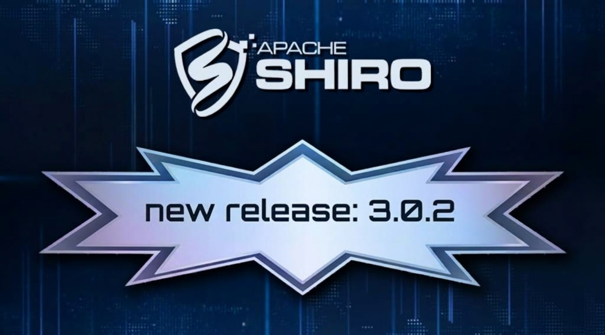

////
# Licensed to the Apache Software Foundation (ASF) under one
# or more contributor license agreements.  See the NOTICE file
# distributed with this work for additional information
# regarding copyright ownership.  The ASF licenses this file
# to you under the Apache License, Version 2.0 (the
# "License"); you may not use this file except in compliance
# with the License.  You may obtain a copy of the License at
#
#   http://www.apache.org/licenses/LICENSE-2.0
#
# Unless required by applicable law or agreed to in writing,
# software distributed under the License is distributed on an
# "AS IS" BASIS, WITHOUT WARRANTIES OR CONDITIONS OF ANY
# KIND, either express or implied.  See the License for the
# specific language governing permissions and limitations
# under the License.
////

= 3.0.2 available
:jbake-author: Lenny Primak
:jbake-date: 2026-11-08 00:00:00
:jbake-type: post
:jbake-status: published
:jbake-tags: blog, release
:idprefix:
:icons: font

The Apache Shiro team is pleased to announce the release of Apache Shiro version 3.0.2.

This release is available for download now.

== Release Highlights

This is a maintenance release with security fixes, a new feature, and a number of improvements and bug fixes. It is recommended that all users upgrade to this version.

== New Features
* Form data can now be saved and replayed without requiring a sign-in page

== Security Fixes
* Superclass and interface annotation processing is harmonized across integrations
* Default settings of `ShiroFilterFactoryBean` and `NoAccessFilter` are now aligned with other components
* Many more hardening and security improvements have been made throughout the framework (see link:/security-reports.html[Vulnerability Reports]).

== Improvements
This release includes various improvements to form data saving and replay, Spring Boot 4.2+ support, logging, SBOM generation, and build and CI stability.

== Bug Fixes
This release includes several bug fixes in Spring configuration, permission handling, and Faces form replay.

== Migration Guide
If you are upgrading from an earlier version of Shiro, please read the link:/migration-guide.html[Migration Guide] for important changes and upgrade instructions.

== Thank you to the following contributors!

* https://github.com/sharanggupta[Sharang Gupta] (first contribution)
* https://github.com/nexory[Nexory]
* https://github.com/balusc[BalusC]
* https://github.com/jbampton[John Bampton]

== Release Notes

The full list of changes is available on link:https://github.com/apache/shiro/releases/tag/shiro-root-3.0.2[GitHub, Release 3.0.2].

== Download

Download and verification instructions are available link:/download.html[on our download page].

== Documentation

For more information on link:/documentation.html[Shiro, please read the documentation.]

Enjoy!

The Apache Shiro Team
